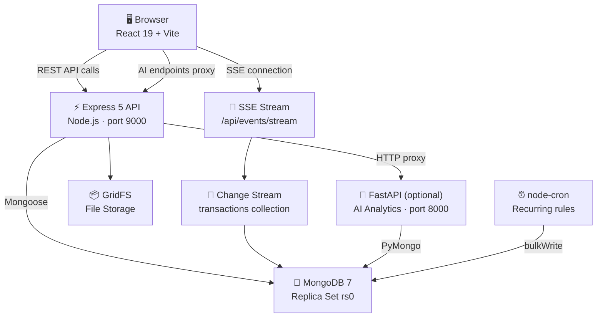
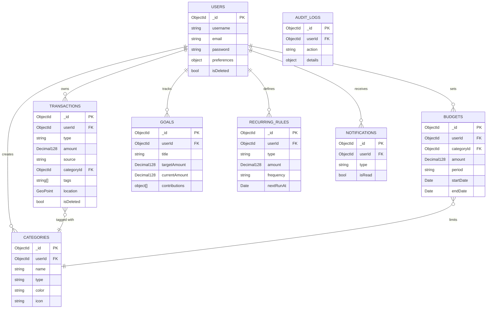

# ExpenseVerse — Personal Finance Tracker

> **A full-stack personal finance app built on React 19, Express 5, and MongoDB — designed to
> demonstrate production-quality backend engineering and a wide range of MongoDB capabilities.**

[](https://github.com/YOUR_USERNAME/expense-tracker/actions/workflows/ci.yml)

---

## Demo Login

The seed script creates a fully-populated demo account. Run `npm run seed` then open the app:

| Field    | Value                        |
|----------|------------------------------|
| Email    | `demo@expensetracker.dev`    |
| Password | `Demo@12345`                 |

The account contains ~750 transactions across 12 months, budgets with intentional alerts, savings goals, recurring rules, and notifications — so every page shows real data immediately.

---

## What is this app?

ExpenseVerse is a personal finance tracker that lets you:

- **Record income and expenses** with categories, tags, payment methods, and optional GPS location
- **Track budgets** per category (monthly, quarterly, yearly) with live spend vs limit bars and alert states
- **Set savings goals** and log contributions — the app shows your progress as a percentage
- **Automate recurring transactions** (salary, rent, subscriptions) with a scheduler
- **Analyse trends** with monthly charts, a 3-month moving average, and a cumulative savings curve
- **Search and filter** all transactions by keyword, category, date range, or amount
- **Get notified** when a budget is near its limit or a goal is achieved
- **Export** income or expense data as Excel files

Everything is backed by MongoDB, and the app is specifically designed to demonstrate real-world MongoDB patterns — not just basic CRUD.

---

## How it works, in 2 minutes

> *For non-developers — using everyday analogies.*

**The database** is like a set of labelled filing cabinets. Each cabinet (collection) holds one type of document:
- The **users** cabinet holds one folder per person, with their name, email, and preferences stapled inside.
- The **transactions** cabinet holds one folder per payment — income or expense — with the amount, date, and category clipped to it.
- The **budgets** cabinet holds the spending limits you set per category.
- The **goals** cabinet holds your savings targets with a running list of contributions.

**An index** is like the alphabetical tab dividers in a cabinet. Without them you would flip through every folder to find "all transactions for user X sorted by date." With an index MongoDB jumps straight to the right folder.

**An aggregation pipeline** is like handing a stack of receipts to your accountant and saying "add up the total, group by category, and tell me which months I overspent." MongoDB does this entirely inside the database — no spreadsheet required.

**A transaction** (the ACID kind, not the money kind) is the "all or nothing" rule. When you add money toward a savings goal, two things must happen together: create the transaction record AND increase the goal's running total. If the server crashes after step one, the database automatically rolls back step one too. Nothing is left half-done.

**A change stream** is like a notification subscription. When a new transaction is saved, MongoDB taps the backend on the shoulder and says "something changed." The backend then sends a real-time update to your browser — no page refresh needed.

### One complete user journey

```
1. You sign up   → Express creates a User document in MongoDB (password hashed
                   with bcrypt before saving, never stored in plain text).

2. You add an expense of $8.50 at Blue Bottle Coffee
                 → Express runs a MongoDB transaction (ACID):
                   a) inserts an Expense document (type: "expense", Decimal128 amount)
                   b) if a budget exists for "Dining & Food", the change stream
                      fires a budget-alert check
                 → Both steps succeed or neither does.

3. MongoDB change stream detects the new document
                 → The backend pushes a Server-Sent Event to your browser tab.
                 → The dashboard updates the "Recent Transactions" list live.

4. Budget check  → The $facet aggregation re-evaluates your Dining & Food budget
                   (actual spend $394 / limit $320 = 123% → status "exceeded").
                 → A Notification document is created.
                 → The bell icon in the navbar shows a red badge.

5. Dashboard load → One MongoDB $facet pipeline returns lifetime totals,
                    30-day period totals, category breakdown, daily trends,
                    and recent transactions — all in a single database round-trip.
```

---

## Architecture



---

## Database Design

### Entity Relationship Diagram



### Collections at a Glance

| Collection | Purpose | Key Design Choice |
|------------|---------|-------------------|
| `users` | Authentication + preferences | Preferences embedded (always fetched with user). Password stored as bcrypt hash. |
| `transactions` | All income and expense records | **Discriminator pattern** — one collection, `type` field distinguishes income/expense. Enables single-pipeline dashboard. |
| `categories` | Labels for transactions | Per-user + system defaults (`userId: null`). Compound unique index prevents duplicate names. |
| `budgets` | Spending limits per category | `startDate/endDate` window evaluated live by aggregation. No stored "spent" counter — that would go stale. |
| `goals` | Savings targets | Contributions embedded (few per goal, always read together). `currentAmount` maintained with `$inc`. |
| `recurring_rules` | Scheduled income/expense | Partial index on `nextRunAt` covers scheduler query (active rules only). |
| `notifications` | Budget/goal alerts | TTL index auto-purges after 30 days. No cleanup job needed. |
| `refresh_tokens` | JWT refresh flow | TTL index auto-expires tokens. Token rotation on every use. |
| `audit_logs` | Change history | Append-only. Capped at system level in the future. |
| `monthly_summaries` | Pre-aggregated reports | Written by `$merge` pipeline. Instant even at 50k transactions. |

---

## MongoDB Concepts Used

| Concept | File | One-line why |
|---------|------|-------------|
| Discriminators | `Transaction.models.js` | One collection for income+expense → single aggregation for balance |
| Decimal128 | All money fields | Avoids floating-point rounding errors in financial calculations |
| Embedded subdocs | `User.preferences`, `Goal.contributions` | Always read with parent; avoids extra round-trips |
| References (ObjectId) | `categoryId`, `recurringRuleId` | Many transactions share categories; normalise to avoid duplication |
| Soft delete | `isDeleted` + `deletedAt` | Preserve audit history; TTL purges after 30 days |
| Compound index (ESR) | `{ userId, date }` | Powers every list query; E=equality, S=sort, R=range |
| Text index | `source, description, notes, tags` | Full-text search bar in Transactions page |
| 2dsphere index | `location` | `$geoNear` for spending-near-me map |
| TTL index | `refreshtokens.expiresAt`, `notifications.createdAt` | Automatic expiry, no cron jobs |
| Partial index | `isDeleted: false`, `isActive: true` | Smaller index, faster queries on the active subset |
| `$facet` | `dashboardAggregations.js` | 5 dashboard facets in one round-trip |
| `$lookup` | `dashboardAggregations.js`, `budgetAggregations.js` | Server-side join: Category name/colour into transactions |
| `$setWindowFields` | `analyticsAggregations.js` | 3-month moving average and cumulative savings (MongoDB 5.0+) |
| `$geoNear` | `transactionController.js` | Nearest transactions to a GPS point |
| `$merge` | `summaryAggregations.js` | Materialise monthly summary for instant reports |
| ACID transactions | `transactionHelper.js` | Atomically create transaction + update goal |
| Change streams | `changeStreamService.js` | Watch transactions collection, push SSE to browser |
| GridFS | `gridfsService.js` | Store files > 16 MB (receipts, avatars) |
| `bulkWrite` | `transactionController.js` | Batch CSV import in one round-trip |
| Keyset pagination | `transactionController.js` | O(log n) pagination, works correctly at any page depth |
| Schema validation | `$jsonSchema` via `syncIndexes.js` | Second layer of validation below Mongoose |
| Optimistic concurrency | `__v` versionKey | Prevent silent overwrites on concurrent edits |

See `docs/MONGODB_CONCEPTS.md` for the full table with file paths and verification steps.

---

## Quick Start

### Option A — Docker Compose (recommended)

Starts MongoDB with a replica set, the Express API, and the Vite frontend with a single command.

```bash
git clone https://github.com/YOUR_USERNAME/expense-tracker.git
cd expense-tracker

# Create backend environment file
cp backend/.env.example backend/.env   # edit with your JWT_SECRET

# Start all services
docker compose up --build

# In a new terminal — seed the demo account
npm run seed
```

Open http://localhost:5173 and log in with `demo@expensetracker.dev` / `Demo@12345`.

### Option B — Without Docker

**Prerequisites:** Node.js 20+, MongoDB 7+ (replica set — see below)

```bash
# 1. Start a local MongoDB replica set
mongod --replSet rs0 --dbpath /data/db --port 27017 &
mongosh --eval "rs.initiate()"

# 2. Backend
cd backend
npm install
cp .env.example .env    # edit MONGO_URI, JWT_SECRET
npm run dev             # http://localhost:9000

# 3. Frontend (new terminal)
cd frontend
npm install
npm run dev             # http://localhost:5173

# 4. Seed demo data (new terminal)
cd ..
npm run seed
```

---

## Environment Variables

### `backend/.env`

| Variable | Required | Description |
|----------|----------|-------------|
| `MONGO_URI` | ✅ | MongoDB connection string (must point to a replica set for transactions) |
| `JWT_SECRET` | ✅ | 32+ character random string for JWT signing |
| `PORT` | | API port (default: `9000`) |
| `CLIENT_URL` | | Frontend origin for CORS (default: `http://localhost:5173`) |
| `AI_SERVICE_URL` | | Python AI service URL (default: `http://localhost:8000`) |

### `frontend/.env` (or Vite env)

| Variable | Description |
|----------|-------------|
| `VITE_API_BASE_URL` | Backend base URL (default: `http://localhost:9000`) |

---

## Seed Commands

```bash
npm run seed          # Create demo user + 12 months of data (idempotent)
npm run seed:reset    # Wipe demo data and re-seed from scratch
npm run seed:bulk     # Insert 50,000 transactions for index/perf testing
```

---
# Expense Tracker

A full-stack personal finance application for recording income and expenses, monitoring balances, and visualizing recent spending. It includes a React dashboard, a protected Express API backed by MongoDB, and an optional Python service for data-driven financial insights.

## Features

- Account registration and sign-in with JWT authentication
- Private income and expense records, each with a source, amount, date, and optional icon
- Dashboard totals for balance, total income, total expenses, recent transactions, and rolling summaries
- Charts, currency selection, transaction deletion, and Excel exports
- Optional AI analytics: expense estimates, category analysis, savings-rate recommendations, and a finance chatbot

## Tech Stack

| Layer | Technologies |
| --- | --- |
| Frontend | React 19, Vite, Tailwind CSS, React Router, Axios, Recharts, Framer Motion |
| API | Node.js, Express, MongoDB, Mongoose, JWT, bcryptjs, Multer, SheetJS (`xlsx`) |
| AI service | Python, FastAPI, Pandas, NumPy, scikit-learn, PyMongo |

## Project Structure

```text
expense-tracker/
├── .github/
│   └── workflows/ci.yml         # GitHub Actions CI (lint, test, build, Docker smoke)
├── backend/
│   ├── index.js                 # Express entry point + route mounts
│   └── src/
│       ├── aggregations/        # $facet, $setWindowFields, $merge pipelines
│       ├── Controller/          # Route handlers
│       ├── Database/            # Connection, syncIndexes, ACID helper
│       ├── middlewares/         # Auth, error handler, validation, rate-limit
│       ├── models/              # Mongoose schemas (User, Transaction, Budget …)
│       ├── Routes/              # Express routers
│       ├── services/            # Change stream, GridFS
│       └── utils/               # asyncHandler, HttpError
├── frontend/
│   └── src/
│       ├── components/          # Reusable UI components
│       │   ├── Cards/
│       │   ├── charts/
│       │   ├── dashboard/       # Dashboard-specific widgets
│       │   ├── layouts/         # DashboardLayout, Navbar, SideMenu
│       │   └── Transactions/    # Add transaction form
│       ├── context/             # UserContext, CurrencyContext
│       ├── hooks/               # useUserAuth
│       ├── pages/
│       │   ├── Auth/            # Login + Signup
│       │   └── Dashboard/       # Home, Transactions, Budgets, Goals,
│       │                        # Categories, Analytics, Notifications,
│       │                        # RecurringRules, Income, Expense, Profile
│       └── utils/               # apiPath.js, axiosInstances.js, helpers
├── ai_services/                 # Optional FastAPI analytics service
├── docs/
│   ├── INDEXES.md               # Index strategy + explain() output
│   ├── MONGODB_CONCEPTS.md      # Full MongoDB concept reference
│   └── ATLAS_SETUP.md           # Production Atlas guide
├── scripts/
│   ├── seed.js                  # Demo data seeder
│   ├── migrate.js               # Old income/expense → transactions migration
│   ├── inspect-indexes.js       # List all indexes on every collection
│   └── explain-check.js         # Run explain() on key queries
├── docker-compose.yml
├── AUDIT.md
├── PROGRESS.md
└── README.md
```

---

## API Reference

All endpoints (except `/api/auth/register`, `/api/auth/login`, `/api/auth/refresh`) require:

```
Authorization: Bearer <access_token>
```

### Authentication

| Method | Endpoint | Description |
|--------|----------|-------------|
| POST | `/api/auth/register` | Create account |
| POST | `/api/auth/login` | Sign in, returns `{ token, refreshToken, user }` |
| POST | `/api/auth/refresh` | Rotate refresh token, returns new access+refresh token |
| GET | `/api/auth/getUser` | Current user profile |
| PUT | `/api/auth/update-profile` | Update username, preferences, profileImageUrl |

### Transactions

| Method | Endpoint | Description |
|--------|----------|-------------|
| GET | `/api/transactions` | Paginated list (keyset cursor); filter by `type`, `categoryId`, `search`, `startDate`, `endDate` |
| POST | `/api/transactions` | Create a transaction (ACID — links to goal if `goalId` provided) |
| POST | `/api/transactions/bulk` | Import array of transactions via `bulkWrite` |
| GET | `/api/transactions/nearby` | Transactions near a GPS point (`?lat=&lng=&maxDistance=`) |

### Income / Expense (legacy endpoints kept for compatibility)

| Method | Endpoint | Description |
|--------|----------|-------------|
| GET | `/api/income/get` | List income transactions |
| POST | `/api/income/add` | Add an income transaction |
| DELETE | `/api/income/:id` | Soft-delete an income record |
| GET | `/api/income/download-excel` | Export income as `.xlsx` |
| GET | `/api/expense/get` | List expense transactions |
| POST | `/api/expense/add` | Add an expense |
| DELETE | `/api/expense/:id` | Soft-delete an expense |
| GET | `/api/expense/download-excel` | Export expenses as `.xlsx` |

### Dashboard & Analytics

| Method | Endpoint | Description |
|--------|----------|-------------|
| GET | `/api/dashboard` | `$facet` pipeline: lifetime totals, period totals, category breakdown, daily trends, recent transactions |
| GET | `/api/analytics/trends?months=12` | Monthly income/expense with `$setWindowFields` moving average |
| GET | `/api/analytics/breakdown` | Payment method + tag breakdown via `$facet` |
| POST | `/api/analytics/materialize` | Run `$merge` to update `monthly_summaries` |

### Budgets

| Method | Endpoint | Description |
|--------|----------|-------------|
| GET | `/api/budgets` | All active budgets with real-time `spent`, `remaining`, `percentageUsed`, `alertStatus` |
| POST | `/api/budgets` | Create a budget |
| DELETE | `/api/budgets/:id` | Delete a budget |

### Goals

| Method | Endpoint | Description |
|--------|----------|-------------|
| GET | `/api/goals` | All goals with embedded contributions |
| POST | `/api/goals` | Create a goal |
| POST | `/api/goals/:id/contributions` | Add a contribution (updates `currentAmount` atomically) |
| DELETE | `/api/goals/:id` | Delete a goal |

### Categories

| Method | Endpoint | Description |
|--------|----------|-------------|
| GET | `/api/categories` | User categories + system defaults |
| POST | `/api/categories` | Create a custom category |
| DELETE | `/api/categories/:id` | Soft-delete a category |

### Notifications

| Method | Endpoint | Description |
|--------|----------|-------------|
| GET | `/api/notifications` | List notifications; `?unreadOnly=true` to filter |
| PUT | `/api/notifications/read-all` | Mark all as read |
| PUT | `/api/notifications/:id/read` | Mark one as read |
| DELETE | `/api/notifications/:id` | Delete a notification |

### Recurring Rules

| Method | Endpoint | Description |
|--------|----------|-------------|
| GET | `/api/recurring-rules` | List all rules |
| POST | `/api/recurring-rules` | Create a rule |
| PATCH | `/api/recurring-rules/:id` | Update / pause / activate a rule |
| DELETE | `/api/recurring-rules/:id` | Delete a rule |

### Files (GridFS)

| Method | Endpoint | Description |
|--------|----------|-------------|
| POST | `/api/files/upload` | Upload a file (multipart/form-data, field name: `file`) |
| GET | `/api/files/:id` | Stream a file by GridFS ObjectId |

### Events (SSE)

| Method | Endpoint | Description |
|--------|----------|-------------|
| GET | `/api/events/stream?token=<jwt>` | Server-Sent Events stream for real-time transaction updates |

### Health

| Method | Endpoint | Description |
|--------|----------|-------------|
| GET | `/api/health` | Returns DB connection status, replica set flag, uptime |

---

## Testing

```bash
# Backend — Node.js built-in test runner
cd backend
npm test

# Frontend — lint check
cd frontend
npm run lint
```

The backend test suite covers controllers, aggregations, and ACID transaction scenarios using a real MongoDB instance.

---

## CI/CD

The GitHub Actions workflow at `.github/workflows/ci.yml` runs on every push to `main` or `develop`:

1. **Backend job** — installs deps, starts a MongoDB replica set service container, runs `npm test`
2. **Frontend job** — installs deps, runs `npm run lint`, runs `npm run build`
3. **Docker smoke test** (on `main` only) — starts the full stack via `docker compose`, hits `/api/health`

---

## Security Notes

- Passwords are hashed with **bcryptjs** (10 rounds) before storage — never stored in plain text
- Access tokens expire in **1 hour**; refresh tokens expire in **7 days** and are rotated on use
- All requests are sanitised against NoSQL injection with **express-mongo-sanitize**
- CORS is restricted to `CLIENT_URL` only in production
- Rate limiting (100 req / 15 min per IP) via **express-rate-limit**
- Helmet sets security headers on every response
- `.env` files are in `.gitignore` — never commit secrets

---

## Troubleshooting

| Problem | Fix |
|---------|-----|
| `MongoServerError: Transaction numbers are only allowed on a replica set member` | You need a replica set. Use `docker compose up` or follow the manual RS setup above. |
| `MongoNotConnectedError` on startup | Check `MONGO_URI` in `backend/.env`. |
| Dashboard shows 0 for everything | Run `npm run seed` to add demo data. |
| Build fails with `LuXxx is not exported` | Your `react-icons` version renamed some icons. Run `npm install react-icons@latest` in `frontend`. |
| Frontend shows blank page | Make sure backend is running on port 9000 and CORS allows `http://localhost:5173`. |
| Change stream error on first start | MongoDB needs a replica set. Run `rs.initiate()` in the mongo shell. |

---

## Glossary

| Term | Plain-English Definition |
|------|--------------------------|
| **Collection** | A table-equivalent. Holds many documents of a similar shape. |
| **Document** | A JSON-like object stored in MongoDB. Equivalent to a row in SQL. |
| **Index** | A sorted copy of selected fields that makes queries fast. Without an index, MongoDB reads every document. |
| **Aggregation pipeline** | A sequence of stages (match → group → sort → …) that transforms data inside the database. |
| **Discriminator** | A pattern where one collection stores multiple "sub-types" of a document using a type field. |
| **Decimal128** | A 128-bit decimal number type that avoids the rounding errors in JavaScript's 64-bit float. |
| **TTL index** | A special index that automatically deletes documents after a set time. |
| **Change stream** | A feature that lets your application subscribe to changes in a collection in real time. |
| **Replica set** | A group of MongoDB nodes that keep identical copies of the data. Required for ACID transactions. |
| **ACID transaction** | Atomic, Consistent, Isolated, Durable — "all or nothing" guarantees across multiple documents. |
| **GridFS** | A MongoDB specification for storing files larger than 16 MB by splitting them into chunks. |
| **`$facet`** | An aggregation stage that runs multiple sub-pipelines in parallel and returns all results in one response. |
| **`$setWindowFields`** | An aggregation stage (MongoDB 5.0+) for computing window functions like moving averages and running totals. |
| **Keyset pagination** | Pagination using the last seen `{date, _id}` as a cursor, avoiding the O(n) cost of `skip(n)`. |
| **Soft delete** | Marking a record as deleted (`isDeleted: true`) instead of removing it, so data can be restored. |

---

## Roadmap

- [ ] Spending map page (Leaflet + `$geoNear`)
- [ ] Receipt image upload via GridFS (link to transaction)
- [ ] Email notifications for budget alerts (Nodemailer)
- [ ] AI-powered spending recommendations (FastAPI service)
- [ ] PWA / mobile-responsive improvements
- [ ] CSV bulk import UI

---

*No license specified. Add one before publishing.*

Expense_tracker/
+-- frontend/                 # React + Vite client application
|   `-- src/
|       |-- components/       # Layout, form, chart, dashboard, income, and expense UI
|       |-- context/          # User and currency providers
|       |-- pages/            # Authentication and dashboard screens
|       `-- utils/            # Axios setup, API paths, and helpers
+-- backend/                  # Express REST API
|   |-- index.js              # Server entry point
|   `-- src/
|       |-- Controller/       # Auth, transaction, export, and dashboard logic
|       |-- Database/         # MongoDB connection
|       |-- middlewares/      # JWT authentication and upload handling
|       |-- models/           # User, Income, and Expense schemas
|       `-- Routes/           # API route definitions
`-- ai_services/              # Optional FastAPI analytics service
    |-- main.py
    `-- requirement.txt
```

## Prerequisites

- Node.js 18+ and npm
- MongoDB (local instance or MongoDB Atlas connection string)
- Python 3.10+ only if you want to run AI analytics

## Getting Started

### 1. Backend

```bash
cd backend
npm install
```

Create `backend/.env`:

```env
MONGO_URI=mongodb://127.0.0.1:27017/expense-tracker
JWT_SECRET=replace-with-a-long-random-secret
PORT=9000
CLIENT_URL=http://localhost:5173
AI_SERVICE_URL=http://localhost:8000
```

Start the API:

```bash
npm run dev
```

The API runs at `http://localhost:9000`.

### 2. Frontend

In a second terminal:

```bash
cd frontend
npm install
npm run dev
```

Vite will display the local URL, normally `http://localhost:5173`. Open it in a browser, create an account, and start adding transactions.

The frontend currently targets `http://localhost:9000`. Change `frontend/src/utils/apiPath.js` if the API uses another host or port.

### 3. Optional AI service

The AI service reads the same MongoDB data to calculate predictions and spending insights.

```bash
cd ai_services
python -m venv .venv
# Windows PowerShell
.\.venv\Scripts\Activate.ps1
pip install -r requirement.txt
pip install openai
```

Create `ai_services/.env`:

```env
MONGO_URI=mongodb://127.0.0.1:27017/expense-tracker
OPENAI_API_KEY=your_openai_api_key
```

Start the service:

```bash
uvicorn main:app --reload --port 8000
```

To expose AI endpoints through Express, uncomment the following in `backend/index.js`:

```js
app.use("/api/ai", aiRoutes)
```

## API Reference

All endpoints except sign-up and login require `Authorization: Bearer <token>`.

| Method | Endpoint | Description |
| --- | --- | --- |
| POST | `/api/auth/signup` | Create an account |
| POST | `/api/auth/login` | Sign in and receive a JWT |
| GET | `/api/auth/getInfo` | Retrieve the authenticated user |
| POST | `/api/income/add` | Add an income transaction |
| GET | `/api/income/get` | List the current user's income transactions |
| DELETE | `/api/income/:id` | Delete an income transaction |
| GET | `/api/income/downloadexcel` | Export income data as an Excel file |
| POST | `/api/expense/add` | Add an expense transaction |
| GET | `/api/expense/get` | List the current user's expense transactions |
| DELETE | `/api/expense/:id` | Delete an expense transaction |
| GET | `/api/expense/downloadexcel` | Export expense data as an Excel file |
| GET | `/api/dashboard` | Get balance totals, recent items, and rolling summaries |
| GET | `/api/ai/predict-expense` | Estimate the next month's expense* |
| GET | `/api/ai/analyze-spending` | Analyze categories and transaction patterns* |
| GET | `/api/ai/recommendations` | Generate savings and category recommendations* |

\*Requires the AI service and enabled AI proxy route.

## Data Model

- **User**: `username`, `email`, hashed `password`, optional `profileImageUrl`, timestamps.
- **Income**: `userId`, `source`, `amount`, `date`, optional `icon`, timestamps.
- **Expense**: `userId`, `source`, `amount`, `date`, optional `icon`, timestamps.

Every income and expense record is associated with its owner. Protected routes use JWT identity to scope reads, exports, and deletes.

## AI Analytics

- With fewer than 10 expense records, the prediction endpoint uses a weighted recent/overall moving average.
- With 10 or more records, it aggregates expenses by month and applies linear regression.
- Spending analysis groups expenses by source and can cluster transaction sizes when enough data exists.
- Recommendations compare income, expenses, savings rate, and category concentration.

These insights are informational only and are not financial advice.

## Available Scripts

| Directory | Command | Purpose |
| --- | --- | --- |
| `backend` | `npm run dev` | Start Express with Nodemon |
| `frontend` | `npm run dev` | Start the Vite development server |
| `frontend` | `npm run build` | Create a production frontend build |
| `frontend` | `npm run lint` | Run ESLint |
| `ai_services` | `uvicorn main:app --reload --port 8000` | Start the AI service |

## Configuration and Security Notes

- Keep `.env` files out of version control; never commit database URIs, JWT secrets, or API keys.
- Use a strong, unique `JWT_SECRET` outside local development.
- Set `CLIENT_URL` to the deployed frontend origin in production to restrict CORS.
- The chatbot requires an OpenAI API key and a compatible OpenAI Python SDK.

## Current Integration Notes

- AI proxy routing is disabled by default in `backend/index.js`; enable it only after the Python service is running.
- The frontend contains profile-image upload and profile-update paths, but their backend routes are currently commented out or absent.
- Frontend export constants use `download-excel`, while the registered backend routes use `downloadexcel`. Align those paths before exposing Excel export in the UI.

## License

No license has been specified. Add one before redistributing or publishing the project.
